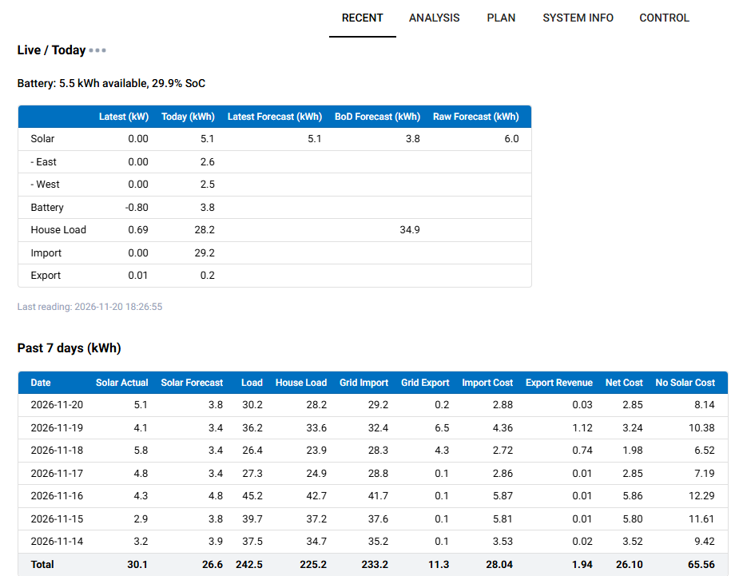
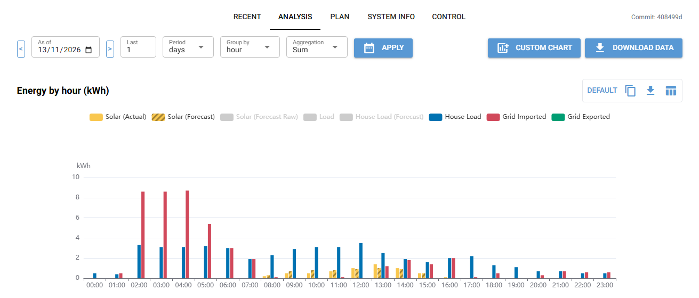
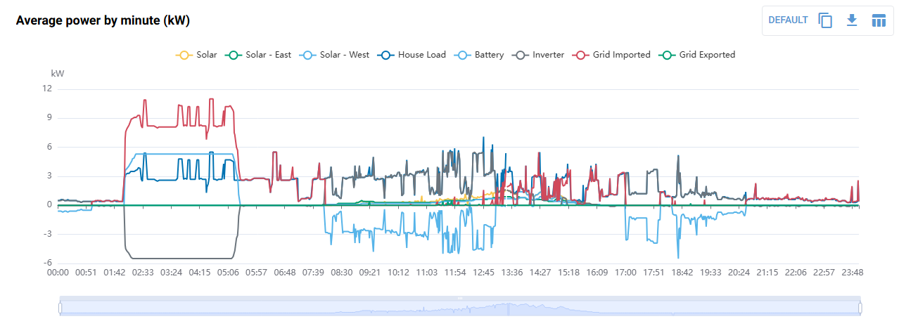
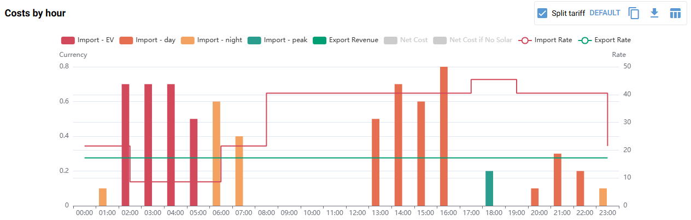

# Solar model collectors

Solar Model is a standalone web app that runs in Docker. It collects Sigenergy solar, battery, and grid readings over Modbus TCP and displays live and historical energy data. It uses solar and household load forecasts and electricity tariffs to create a battery energy plan. The plan is currently advisory only.

Start with the [project documentation](documentation/index.md) for architecture, code structure, storage, forecasting, planning, styling, and review findings. Future agents should also read [AGENTS.md](AGENTS.md).

## Desktop screenshots

### Plan
This pic shows the plan (dashed line) as of a point in time. A snapshot can be selected to overlay how actuals compare to plan.
[](documentation/screenshots/plan.png)

<details>
<summary>Plan detail table</summary>

[](documentation/screenshots/plan-detail.png)

</details>

### Recent table

[](documentation/screenshots/table.png)

### Analysis

[](documentation/screenshots/analysis.png)

<details>
<summary>More Analysis Charts - Power, battery, solar array and tariff charts</summary>

[](documentation/screenshots/analysis-power.png)

[](documentation/screenshots/analysis-battery.png)

[](documentation/screenshots/analysis-solar-arrays.png)

[](documentation/screenshots/analysis-costs.png)

</details>

## Install

### Docker Compose

Save [compose.yaml](compose.yaml) on your Linux Docker host. The service builds from the latest commit on `master` each time you rebuild.

```yaml
services:
  solar-model:
    build:
      context: "https://github.com/gleesonger/solar_model.git#master"
    user: "1000:1000"
    environment:
      NUMBA_CACHE_DIR: /config/.numba-cache
      SOLAR_MODEL_PORT:
    restart: unless-stopped
    ports:
      - "${SOLAR_MODEL_PORT:-8090}:${SOLAR_MODEL_PORT:-8090}"
    volumes:
      - ./solar-model:/config
```

The example uses UID and GID `1000:1000`. If `id -u` or `id -g` prints a different number on your host, update `user:` in `compose.yaml`. From the directory containing `compose.yaml`, create the data directory and start the service as your regular user.

```sh
mkdir -p ./solar-model/.numba-cache
docker compose up -d --build
```

To run the dashboard on another port from the first start, set `SOLAR_MODEL_PORT=8091` in a `.env` file beside `compose.yaml`. This sets both the published port and the port the dashboard listens on. Use that port in the dashboard URL. Run `docker compose up -d` after changing it.

If you already have root-owned files from a previous install, see [Docker file ownership](documentation/operations/runbook.md#docker-compose-file-ownership).

The container creates `./solar-model/config.yaml` on first start and stores its SQLite database in the same directory. Set `actuals.modbus.host` to your Sigenergy system's IP address and configure your solar arrays and tariffs in that file. After editing, open [the dashboard](http://localhost:8090) and choose **Control → Restart application** to reload the configuration. If the dashboard is unavailable, run `docker compose restart solar-model`.

### Run from source

The managed application launcher starts the minute-resolution electrical and forecast collector and dashboard:

```powershell
python docker_start.py
```

Use this launcher when using the dashboard Control tab: it is what allows tariff recalculation to restart the entire application and reload `config.yaml` for all three services. `solar_model/runtime/collector.py` and `solar_model/dashboard/app.py` may still be launched independently for development, but the Control tab cannot restart an independently launched collector.

`solar_model/runtime/collector.py` synchronizes to the next configured full interval (shipped as 60 seconds), runs Modbus first, and runs Forecast.Solar at its configured interval when due. A failed interval is logged and skipped. The collector modules expose one-pass functions and are not standalone schedulers.

The dashboard runs a lightweight background collector for the `Latest (kW)` column. It reads the configured plant power values and mapped PV-string power values at the live interval, retaining only the newest successful result in memory.

Set `actuals.data_retrival_schedule.full_updated_interval_seconds` in `config.yaml` to change the full data-refresh interval; the shipped value is `60` seconds.

Set `actuals.data_retrival_schedule.live_update_interval_seconds` to change the live Modbus polling and browser refresh interval; the shipped value is `1` second.
The dashboard polls live power once per second only while at least one browser is connected.
Set `forecast.solar.interval_seconds` in `config.yaml` to change the minimum elapsed time between forecast scans; it is configured for `3600` seconds.

Configuration loading checks required fields, types, and supported values during startup. Unknown YAML keys are currently ignored. See [configuration](documentation/overview/configuration.md) for validation and optional fields.

SQLite schema creation, migrations and collector writes are handled by `solar_model/storage/`. Maintenance scripts also issue direct SQL updates. See [data model](documentation/overview/data-model.md) for storage units and migration effects.

## Tariffs and economics

Configure effective-dated periods under `tariffs.periods`, each containing import/export time-of-use rules. `start_time` and `end_time` use strict 24-hour `HH:MM` format. `end_time` may also be `24:00` for midnight at the end of that day; `start_time` must be from `00:00` through `23:59`. A rule applies from its start time inclusive until its end time exclusive, using the local configured timezone. A rule may cross midnight; its `days` names the day on which it starts. Equal start and end times describe a full 24-hour day. Every weekday/minute must be covered by exactly one import rule and one export rule per period; import rules require a band name.

```yaml
tariffs:
  periods:
    - effective_from: "2000-01-01"
      import:
        - days: [Mon, Tue, Wed, Thu, Fri, Sat, Sun]
          name: flat
          start_time: "00:00"
          end_time: "24:00"
          rate: 0.35
      export:
        - days: [Mon, Tue, Wed, Thu, Fri, Sat, Sun]
          start_time: "00:00"
          end_time: "24:00"
          rate: 0.10
```

For each new actual sample, the collector stores the selected import and export rates, import cost, export revenue, net cost (`import - export`), and the positive import cost that would have applied without solar or battery (`load × import rate`). These values are not retroactively recalculated when rates change; the Recent tables aggregate the values stored with each sample.

## Forecast

The arrays are parameterized in `config.yaml`:

| Panel ID | Name | Latitude | Longitude | Declination | Azimuth | Peak |
| --- | --- | ---: | ---: | ---: | ---: | ---: |
| 1 | East | 53.4508401 | -6.15367 | 35 | -67.5 | 6.175 kWp |
| 2 | West | 53.4508401 | -6.15367 | 35 | 112.5 | 5.225 kWp |

The API returns cumulative `watt_hours` values for forecast timestamps and daily totals. Forecast.Solar public access may return hourly data; 15-minute data depends on the account plan.

Forecast rows retain the provider response as `panel_n_raw_*` and store the operational forecast as `panel_n_adj_*`. Raw values are never changed. The operational forecast uses the final provider snapshot available before local midnight for the entire day, applies a system scalar per UTC hour calibrated from the preceding eight weeks with a three-week (21-day) half-life, then applies an intraday normal-score residual from completed PV observations (one-hour half-life). Each hourly provider collection stores its own adjusted snapshot; the dashboard shows start-of-day raw values and the newest adjusted values. The residual only changes future target hours.

To replace legacy adjusted values historically without changing the schema or raw data, run the chronological rebuild. It clears previous adjusted values and writes the revised series to each replayed collection snapshot; `--apply` is required because this changes the database:

```powershell
python -m solar_model.tools.rebuild_forecasts --database solar.db --start 2026-08-22 --end 2026-10-04 --apply
```

`--start` and `--end` are optional. With neither supplied, the script rebuilds from the earliest available forecast target through the latest available actual; supplying only one bound infers the other.

Compare raw and adjusted forecast power against actual plant PV output with the read-only performance report. It reports MAE, RMSE, bias, and MAE improvement overall and by forecast lead time. Use `--date` to test one local target day:

```powershell
python -m solar_model.tools.evaluate_forecasts --database solar.db --date 2026-09-15
```

Each forecast array requires a unique integer `panel_id` from `1` through `4` and a unique `name`. `dashboard.actuals_to_forecast` associates inverter PV inputs with array names. For example, `pv1: East` compares inverter string PV1 with the forecast array named `East`. Names must match exactly; storage and chart columns continue to use panel IDs internally.

## Modbus register map

Sigenergy register addresses and scaling are firmware/device dependent. The supplied maps are aligned to *Sigenergy Modbus Protocol EN V2.9* (released 2026-05-13). The collector reads contiguous groups. The supplied `solar_model/integrations/sigenstor/register_maps/sigen_register_map.json` contains electrical metrics, while `solar_model/integrations/sigenstor/register_maps/sigen_device_register_map.json` contains the device and system metadata recorded when values change. Their files are packaged under `solar_model/integrations/sigenstor/register_maps/` and loaded by `solar_model/integrations/sigenstor/registers.py`; they are not dashboard configuration settings.

Each entry has this shape:

```json
{
  "metric": "battery_power_w",
  "address": 1234,
  "kind": "holding",
  "unit": "W",
  "scale": 0.1,
  "cumulative": false
}
```

Use `input` or `holding` for `kind`. Addresses are passed to pymodbus as zero-based addresses. For each metric marked `cumulative`, `period_kwh` is calculated from the previous successful sample, including the latest persisted value after a restart; counter resets and decreases produce `NULL`.

The requested device defaults are Modbus TCP host `192.168.1.130` and port `502`. The supplied maps use the Sigenergy plant unit ID `247` and inverter unit ID `1`; set explicit `device_id` values in the register maps when your topology differs. Set `database.path` in `config.yaml` to change the SQLite path.

The database uses explicit SQLAlchemy models. `sigenstor` has one row per electrical sample; `sigenstor_hourly` stores UTC-hour/tariff-band aggregates; `sigenstor_devices` records valid device-information changes. Known inverter models add nameplate maximum PV input power. `forecast_solar` is keyed by collection and target time, with `panel_n_raw_*` provider values and `panel_n_adj_*` model output. Opening the database performs automatic schema migration and may backfill hourly data. Measurements are integers scaled by 10,000; ORM reads convert to physical units. Measurement timestamps are UTC epoch seconds, while device-history timestamps are ISO text. Metric names include units, such as `plant_pv_power_kw` and `plant_battery_soc_percent`; cumulative metrics also have `_period` columns. See [data model](documentation/overview/data-model.md) for details.

## Dashboard

For dashboard-only development, start the NiceGUI dashboard with:

```powershell
python main_dashboard.py
```

For normal operation, use `python docker_start.py` above so that the Control tab can restart both this process and the data collector.

The dashboard listens on `SOLAR_MODEL_PORT` when set, otherwise it uses `dashboard.port` from `config.yaml`. Live cells update in place at the configured live interval (shipped as one second) and remain blank until the first successful reading. Shared Recent/System Info data refreshes at the full interval; Analysis loads on demand and when its controls are applied. Mapped PV-string voltage/current readings provide proportions for allocating plant solar energy and power. The battery chart uses plant available-discharge telemetry; it does not derive available energy from state of charge. See [dashboard](documentation/overview/dashboard.md) and [styling](documentation/overview/styling.md).

The [Docker Compose install](#docker-compose) starts the collector, planner, and dashboard. Change the Compose port mapping if you change the configured dashboard port.

The dashboard shows a persistent warning across all tabs when the browser is offline, the server connection stops updating, or the readings become stale. Returning to a suspended phone tab requires a fresh server heartbeat before the connection warning clears. NiceGUI reconnects automatically; a Reload button is also available. Live readings are marked stale after the greater of 15 seconds or three live polling intervals. Missing or stale readings wait for new data without repeatedly reloading the page. Reconnecting also reapplies the latest shared snapshot.

Warning policy is centralised in `solar_model/dashboard/components/warnings.py` and `solar_model/dashboard/assets/warnings.js`. Connection and data-freshness problems share one persistent banner across all tabs, in priority order: offline, disconnected, missing server heartbeat, missing/stale collected data, then missing/stale live readings. The banner clears automatically only after recovery. Tabs publish timestamps without creating their own warning labels or refresh loops. Validation, load, and action failures use the shared red notification at the top, with a Dismiss button and a 10-second timeout; informational and success notifications use the same placement with a 5-second timeout. Progress labels remain local to the action without duplicating its error details.

## Package structure

Application code is under `solar_model/`, split into planning, services, integrations, storage, dashboard, runtime and tools. See the [code map](documentation/overview/code-map.md). Existing root launch commands continue to work. Install with `python -m pip install -e ".[test]"`; browser checks additionally need `.[browser]` and a Playwright browser installation.

The as-of report command is `python -m solar_model.tools.plan_as_of --database solar.db --as-of "2026-10-24T10:00:00+01:00"`. Its planning API accepts in-memory device/state/scenarios through `solar_model.planning.plan_optimisation_milp.simulate_energy_plan` and returns `SimulationResult`. Planning remains read-only, with shared first controls and the [tariff-scaled cost/protection score](documentation/overview/plan-model.md); hardware command verification and forecast/scenario changes remain separate work.

Scheduled plans are produced by `python -m solar_model.runtime.planner`, independently of the dashboard. The managed launcher starts it automatically. The Plan tab shows latest or selected saved snapshots using blank-by-default date/snapshot controls beside Plan settings.

Use the complete `config.yaml` example when updating a deployment. Settings must be supplied explicitly, including `null` for nullable values. `SOLAR_MODEL_PORT` can supply `dashboard.port` at runtime.

Energy planning uses Markov DP only. Optimiser settings are explicitly required in the flat `energy_plan.optimiser` block; old model selectors, nested solver blocks and refinement stages are rejected. See [configuration](documentation/overview/configuration.md#markov-optimiser) when updating a deployed YAML file.
