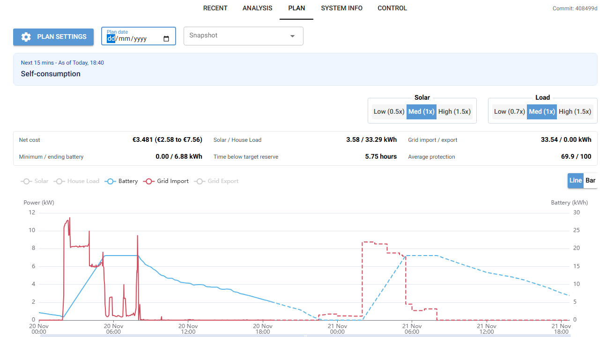
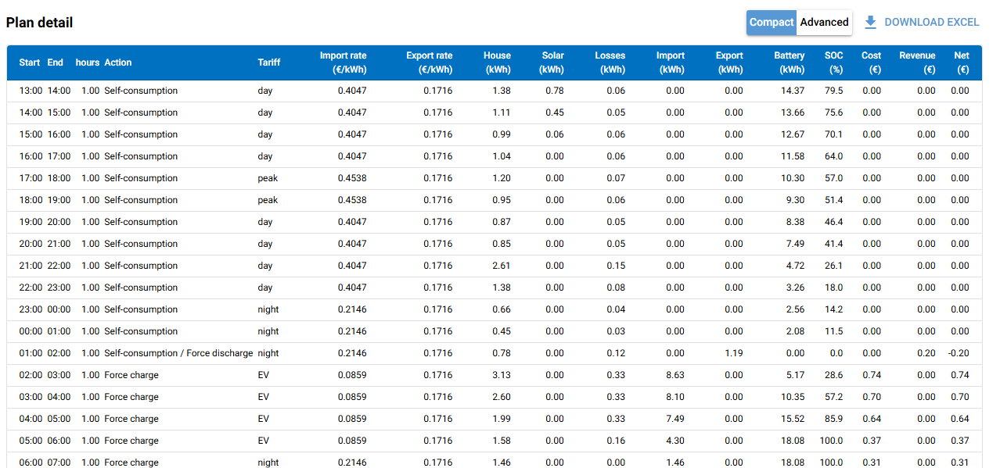
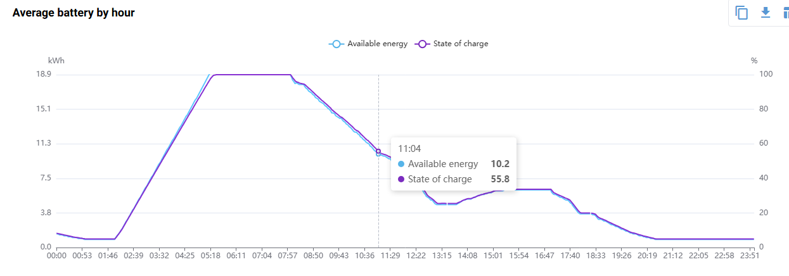
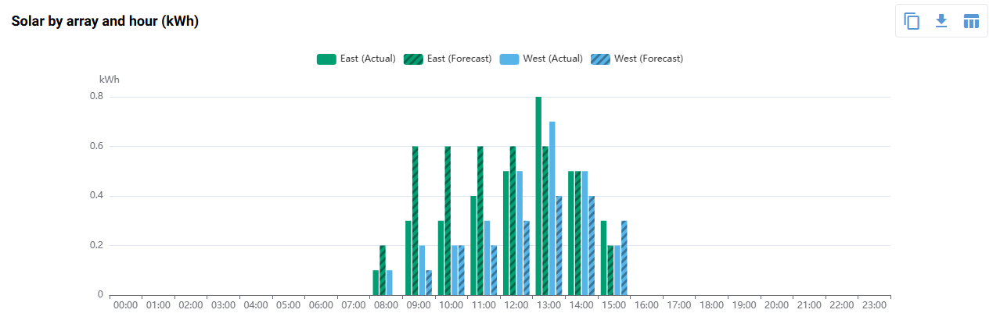

# Solar model collectors

Solar Model is a standalone web app that runs in Docker. It collects Sigenergy solar, battery, and grid readings over Modbus TCP and displays live and historical energy data. It uses solar and household load forecasts and electricity tariffs to create a battery energy plan. The plan is currently advisory only.

Start with the [project documentation](documentation/index.md) for architecture, code structure, storage, forecasting, planning, styling, and review findings. Future agents should also read [AGENTS.md](AGENTS.md).

## Contents

- [Desktop screenshots](#desktop-screenshots)
- [Install](#install)
- [Configuration](documentation/overview/configuration.md)
- [Documentation](#documentation)

## Desktop screenshots

### Plan
This pic shows the plan (dashed line) as of a point in time. A snapshot can be selected to overlay how actuals compare to plan.
[](documentation/screenshots/plan.png)

[](documentation/screenshots/plan-detail.png)

### Recent table

[](documentation/screenshots/table.png)

### Analysis

[](documentation/screenshots/analysis.png)

[](documentation/screenshots/analysis-power.png)

[](documentation/screenshots/analysis-battery.png)

[](documentation/screenshots/analysis-solar-arrays.png)

[](documentation/screenshots/analysis-costs.png)

## Install

### Option 1 - Docker Compose

**1. Create application folder**

```bash
mkdir -p solar-model
cd solar-model
```

**2. Download the config file**

```bash
mkdir -p ./config
curl https://raw.githubusercontent.com/gleesonger/solar_model/master/config.yaml -o ./config/config.yaml
```

**3. Edit the config file**

Edit `./config/config.yaml` before starting Solar Model.

- **Sigenergy IP address**. Set `actuals.modbus.host` to the IP address of your system.
- **Electricity prices**. Set what you pay for grid power and what you earn for exports in `tariffs.periods`. See [tariff example](documentation/overview/configuration.md#tariff-example).
- **Time zone**. Set `timezone` so tariff hours and daily totals follow local time.
- **Solar panels**. In `forecast.solar.arrays`, set your location, each array’s tilt, direction and size in kWp. Match the array names to your inverter inputs in `dashboard.actuals_to_forecast`.

**4. Start Solar Model.**

```bash
curl https://raw.githubusercontent.com/gleesonger/solar_model/master/compose.yaml -o ./compose.yaml
docker compose up
```

The Compose file runs as `1000:1000`. Check your host IDs with `id -u` and `id -g`. If they differ update the config.

**5. Open Browser**

Open the dashboard (http://localhost:8090). From another machine, use the Docker host’s address and published port.

To reflect changes in `./config` restart the application using wither **Control → Restart application** or docker compose down/up

### Option 2 - Run from source

Use Python 3.12 or later. From the repository root, edit `config.yaml` using the settings in [step 3](#option-1---docker-compose), then install and start the app.

```bash
cd solar_model
git clone https://github.com/gleesonger/solar_model.git
python -m pip install -e .
# Update Config#
python docker_start.py
```

## Documentation
- [Configuration](documentation/overview/configuration.md)
- [Dashboard guide](documentation/overview/dashboard.md)
- [Forecasting](documentation/overview/forecasting.md) and [battery planning](documentation/overview/plan-model.md)
- [Collection and Modbus registers](documentation/overview/collection.md)
- [Operations and troubleshooting](documentation/operations/runbook.md)
- [Package and code map](documentation/overview/code-map.md)
