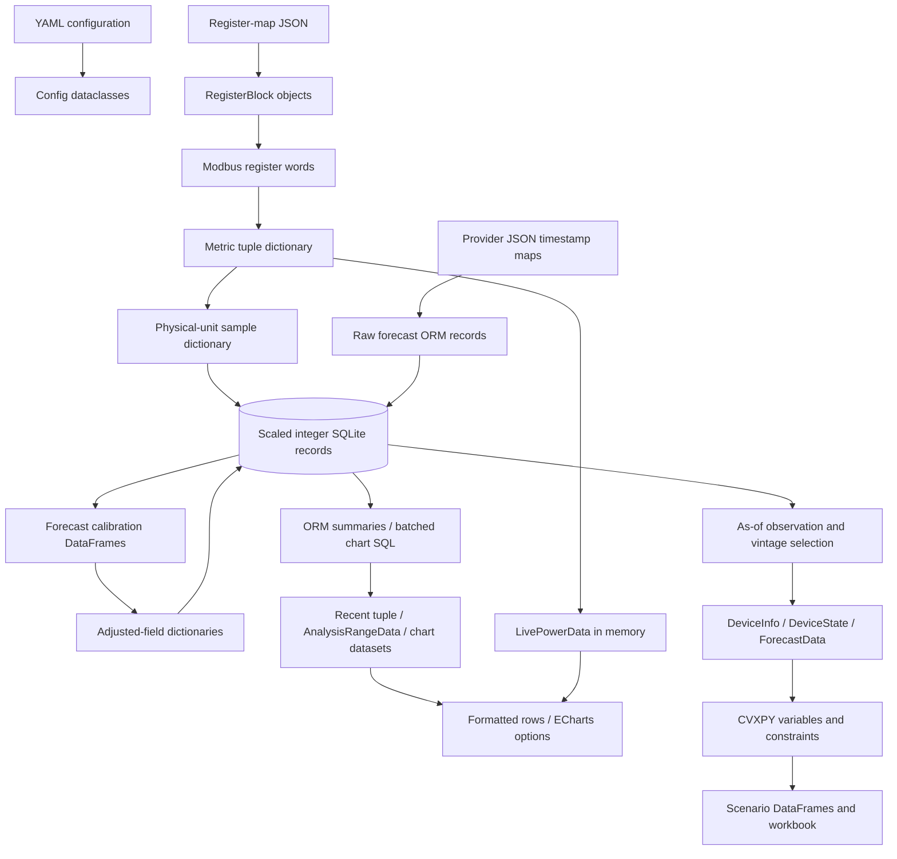

# Implementation and data-flow reference

This is the detailed companion to the [project overview](../index.md). It explains the reviewed code's function hierarchy, object ownership, queries, intermediate data, transformations, and persistence boundaries. Read the relevant overview first, then follow the pipeline below.

## Pipeline guides

| Stage | Detailed guide | Main questions answered |
| --- | --- | --- |
| Process startup | [Runtime and configuration](runtime.md) | What calls what? Where do configuration, workers, and client state live? |
| External inputs | [Collection and ingestion](collection.md) | What do register definitions, decoded readings, and provider responses look like? |
| Persistence | [Storage and retrieval](storage.md) | What is derived, stored, aggregated, and returned by ORM/raw SQL? |
| Schema fields | [Exact schema reference](../reference/schema.md) | Every declared column, storage/API type, nullable state, key, and index |
| Forecast correction | [Operational forecasting](forecasting.md) | Which frames train/calibrate the model, which vintage is used, and what is written? |
| Dashboard queries | [Dashboard data processing](dashboard-data.md) | Which DB fields are loaded, how are datasets transformed, and what do returned frames contain? |
| Live/UI consumers | [Dashboard state and presentation](dashboard-ui.md) | How do cached/live data become browser tables, charts, exports, and warnings? |
| Optimisation | [Planning inputs and results](planning.md) | How do stored observations become interval forecasts, solver variables, and workbook rows? |
| Offline tools | [Maintenance and research](maintenance-research.md) | What do recalculation, replay, evaluation, model training, and tariff experiments consume/produce? |

## End-to-end map

## How to read the data examples

- Examples are **synthetic and abbreviated**, illustrating contracts rather than actual device/API captures. Omitted fields are labelled; use source declarations for the complete schema.
- SQL examples describe query shape; they are not maintenance commands to execute against `solar.db`.
- Physical units apply to decoded readings, ORM values, and most returned frames. Raw SQL starts in fixed-point storage units unless explicitly converted.
- Collection time identifies the knowledge/vintage boundary; forecast target time identifies the predicted interval. Neither is interchangeable with a local calendar bucket.
- `None` is a nullable scalar, `NaN` a pandas missing value, and `null` the browser representation. Some paths replace missing values with zero; each guide identifies where.
- Frozen dataclasses fix attribute assignments, not the contents of contained DataFrames/dictionaries. Shared snapshots are not deeply immutable or one atomic database read.
- Call trees show application-owned calls and important library boundaries. They do not enumerate every formatting helper or every library-internal call.

## Names that change meaning between stages

| Name | Context-specific meaning |
| --- | --- |
| `battery` | Live: signed device kW; Recent/Analysis energy: charge minus discharge kWh; custom chart: available-energy level, with a fallback |
| `forecast_total` | Aggregated energy from the forecast source selected by that loader; it does not imply a universal snapshot policy |
| `actual_panel_n` | Plant solar kWh allocated by measured string-energy weights, after allocation; before allocation it may be the weighting energy itself |
| `panel_n_raw_watts` | Raw SQL: W × 10,000; ORM: physical W; model's `raw_n_kw`: physical kW |
| `collected_at_local` | Device table: stored text; electrical/forecast models: host-timezone-derived hybrid property |

## Baseline and verification

- Source rechecked on 2026-10-14 at `6452e13ae3d8828580ae9df489ef341a2a8e263b`, including the local untracked load-profile experiment.
- These guides describe existing implementation, including limitations. They do not change algorithms or define new program requirements.
- The [review findings](../reviews/findings.md) remain the record of unresolved issues. Current instructions in [AGENTS.md](../../AGENTS.md) require reviewing and maintaining both overview and implementation guides with future changes.
