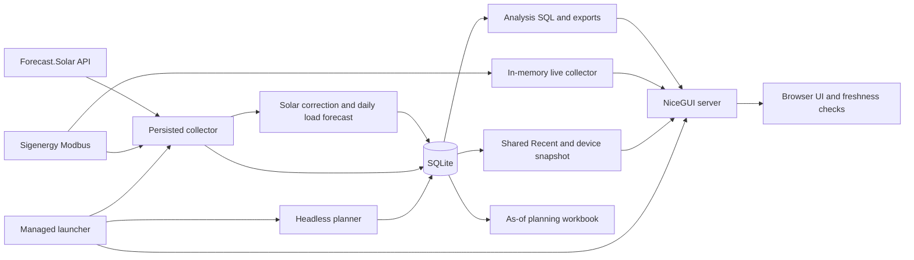

# Architecture

Detailed startup/call hierarchies and object ownership are in [runtime.md](../implementation/runtime.md); stage-by-stage data contracts start at the [implementation index](../implementation/index.md).

## Runtime ownership

- Root launchers forward to `solar_model.runtime.supervisor`, `solar_model.runtime.collector` and `solar_model.dashboard.app`, preserving existing commands.
- The supervisor initialises storage and manages the persisted collector, independent planning service and NiceGUI server. The collector calls collection/forecasting services; the dashboard owns its snapshot worker and browser-activated live collector.
- `solar_model.storage` owns schema, migrations, measurements, forecast persistence and queries. Data-only query results do not depend on NiceGUI.
- `solar_model.planning` owns pure forecasts, planning inputs, scenarios, physical limits, scoring and optimisation. `services.planning` loads as-of data; `tools.plan_as_of` writes reports. The independent planner owns scheduled calculations/publication after eligible full electrical updates. The dashboard observes saved IDs, caches reports and owns only private demonstration calculations. Planning sends no device commands.



## Execution and concurrency

- Collector work is sequential: full electrical sample, optional device information, then due forecast collection/correction. Slow work delays the next cycle; missed slots are not queued.
- The supervisor opens/migrates the database before starting either child. Children also open it at startup; standalone entry points therefore initialise it themselves.
- Dashboard database work runs in NiceGUI `run.io_bound` workers. The shared snapshot swaps references under a lock and notifies browser subscribers.
- Each browser owns its tab state, UI elements, live-refresh timer, and warning heartbeat. Recent/System Info share server data; Analysis queries are selected per browser.
- Live polling runs in a daemon thread and pauses when no browser socket is connected. It retains the newest successful reading without persisting it.
- SQLite coordinates access between processes. No explicit WAL setup, custom busy timeout, or central write queue is configured in the source.

## Design boundaries

- Integration clients fetch/decode; services orchestrate; storage persists/queries; planning calculates; dashboard components format/render. Native SQL aggregation remains in storage queries.
- Browser JavaScript evaluates connectivity/freshness and the live-update indicator; Python publishes timestamps and sends heartbeats.
- Dashboard Control actions trigger tariff recalculation and process restarts, not inverter charge/discharge commands.
- Offline experiments and generated workbooks are separate from the managed application.

See [code-map.md](code-map.md) for implementation locations and [review findings](../reviews/findings.md) for boundary inconsistencies.

Shared plan workers prepare report views and commit snapshots before notifying the server. The server loads the committed ID and shares its cache with browsers; Plan History reads the same table. See [saved plans](../implementation/plan-history.md).

## Process ownership and recovery

```text
supervisor
  collector process: persisted measurements and due forecast work
  planner service process: scheduling, health and one calculation worker
    calculation process: fresh-cutoff optimiser, report preparation and atomic save/retention
  dashboard process: saved-plan cache, UI, live Modbus thread and query thread pool
    on-demand private demonstration process (no queue)
```

Unexpected exits restart only the affected service with 1?30 second backoff. POSIX services own process sessions; Windows services own kill-on-close Job Objects, so descendants are cleaned even after the service root crashes. Supervisor-requested restart reloads the whole application. Windows Job cleanup forcibly terminates services; SQLite atomic transactions protect interrupted writes. Planner health is refreshed every five seconds; the dashboard flags stopped or older-than-20-second status.
